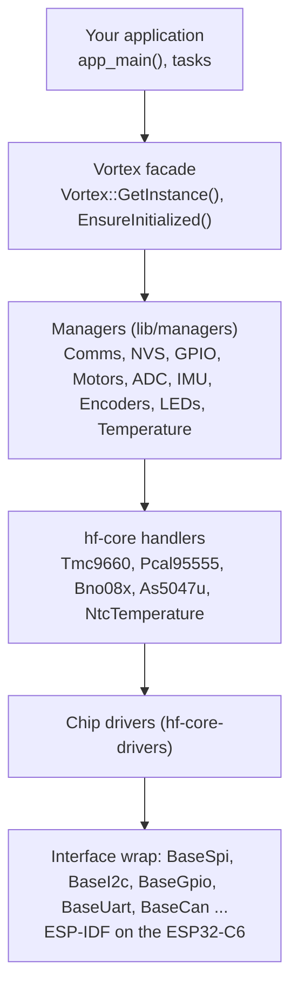

# HardFOC Vortex V1 HAL

Hardware abstraction layer for the **HardFOC Vortex V1** motor controller board: an ESP32-C6 with a TMC9660 motor
controller, an AS5047U encoder slot, a BNO08x IMU, a PCAL95555 I/O expander, temperatures, CAN and a status LED,
through one `Vortex` object.

[](https://github.com/hardfoc/hf-hal-vortex-v1/actions/workflows/esp32-examples-build-ci.yml)
[](https://github.com/hardfoc/hf-hal-vortex-v1/actions/workflows/ci-docs-publish.yml)
[](https://hardfoc.github.io/hf-hal-vortex-v1/)
[](https://github.com/hardfoc/hf-hal-vortex-v1/blob/main/LICENSE)

**Documentation: <https://hardfoc.github.io/hf-hal-vortex-v1/>**

## Architecture

Your application talks to the `Vortex` facade; each layer calls only the one below it.



The site explains each layer: [architecture](https://hardfoc.github.io/hf-hal-vortex-v1/latest/architecture/),
[managers](https://hardfoc.github.io/hf-hal-vortex-v1/latest/managers/),
[hardware and pin map](https://hardfoc.github.io/hf-hal-vortex-v1/latest/hardware/).

## Quick start

You need ESP-IDF release/v5.5 (`esp32c6` target) and a Vortex V1 board on USB.

```bash
git clone --recurse-submodules https://github.com/hardfoc/hf-hal-vortex-v1.git
cd hf-hal-vortex-v1/examples/esp32
./scripts/build_app.sh vortex_api_test Release
./scripts/flash_app.sh flash_monitor vortex_api_test Release
```

The log ends with a `Component Status` line: `OK` or `FAIL` per manager. Step by step, with how to tell each step
worked: [Get started](https://hardfoc.github.io/hf-hal-vortex-v1/latest/getting-started/).

## Use it

```cpp
#include "api/Vortex.h"
#include "managers/EncoderManager.h"
#include "managers/LedManager.h"
#include "managers/TemperatureManager.h"

extern "C" void app_main() {
    auto& vortex = Vortex::GetInstance();
    if (!vortex.EnsureInitialized()) {
        return;  // NVS, comms, GPIO or the LED failed
    }

    // The encoder is not created automatically: create it on its chip select, then read it.
    double angle_deg = 0.0;
    if (vortex.encoders.CreateAs5047uDevice(0, SpiDeviceId::AS5047U_POSITION_ENCODER)) {
        (void)vortex.encoders.ReadAngleDegrees(0, angle_deg);
    }

    float chip_c = 0.0f;
    (void)vortex.temp.ReadInternalTemperature(chip_c);
    (void)vortex.leds.IndicateReady();
}
```

Motor control goes through `vortex.motors` (the TMC9660); see
[MotorController](https://hardfoc.github.io/hf-hal-vortex-v1/latest/managers/motors/) before you spin a motor.

## Repository layout

| Path | Contents |
| --- | --- |
| `lib/api` | The `Vortex` facade and version information |
| `lib/managers` | One manager per board function |
| `lib/core` | hf-core submodule: handlers, chip drivers, interface wrap, the pin map (`hf-pincfg`) |
| `examples/esp32` | Buildable example, bench and test apps ([catalogue](https://hardfoc.github.io/hf-hal-vortex-v1/latest/examples/)) |
| `third_party/CANopenNode` | CANopenNode submodule, built with the HAL's CANopen option |
| `docs` | The documentation site (MkDocs); figures and tables are generated from the code |
| `_config` | Doxygen, lint and link-check configuration |

## Contributing

Pull requests run the example build, C++ lint and analysis, Markdown and YAML lint, and the docs checks; see
[Testing and CI](https://hardfoc.github.io/hf-hal-vortex-v1/latest/guides/testing-and-ci/). If you change a pin, an
example or a manager's dependencies, run `python3 tools/docs/gen.py` and `python3 tools/figkit/build.py` and commit
the result.

## License

GPL-3.0. See [LICENSE](https://github.com/hardfoc/hf-hal-vortex-v1/blob/main/LICENSE).
