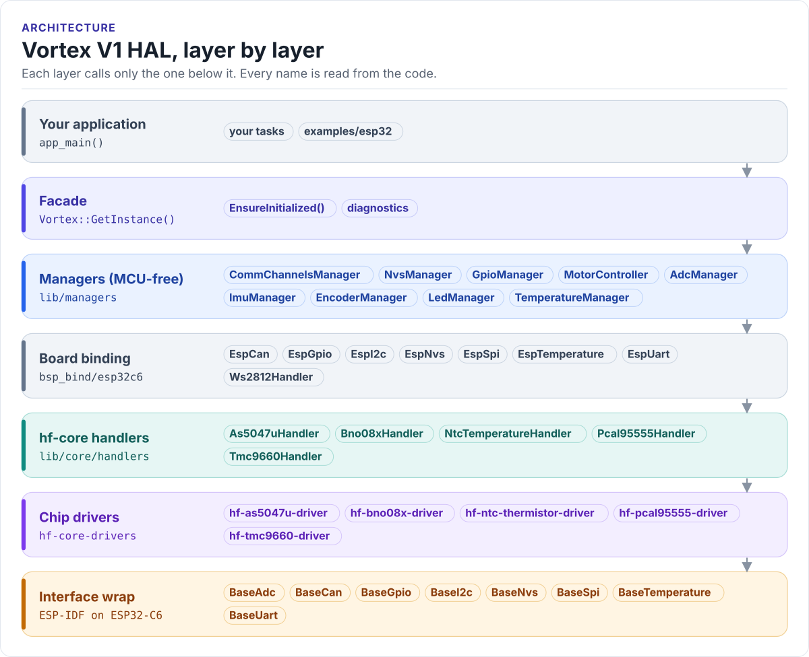

# Architecture

How the Vortex V1 HAL is put together. The short version: your code talks to one object, `Vortex`; `Vortex` holds one
manager per board function; managers own hf-core handlers and get every bus and MCU pin from the board binding;
handlers wrap chip drivers; drivers reach the hardware only through the interface classes of the internal interface
wrap. Only the board binding names an ESP32 type.

<!-- figure: hal-layers -->
<picture>
  <source media="(prefers-color-scheme: dark)" srcset="../diagrams/hal-layers.dark.svg">
  
</picture>
<!-- /figure -->

## The layers

| Layer | Where | What it does | You use it when |
| --- | --- | --- | --- |
| Application | your project, [`examples/esp32`](../../examples/esp32) | Tasks, control loops, protocols | Always |
| Facade | [`lib/api/Vortex.h`](../../lib/api/Vortex.h) | One singleton; brings the managers up in order; system diagnostics | Always: `Vortex::GetInstance()` |
| Managers | [`lib/managers`](../../lib/managers) | One per board function (motors, encoders, IMU, ADC, ...); know the board's wiring from the pin map; MCU-free | Almost always: `vortex.motors`, `vortex.encoders`, ... |
| Board binding | [`lib/managers/bsp_bind`](../../lib/managers/bsp_bind/VortexBoardBind.h) | Creates the buses, MCU pins, NVS namespaces, die sensor and status LED for one MCU (`esp32c6/`), or mocks them for host tests (`host/`) | When porting to another MCU |
| hf-core handlers | `lib/core/handlers` | Wrap one chip driver each and adapt it to the interface classes | Rarely; for chip features a manager does not expose |
| Chip drivers | `lib/core/hf-core-drivers/external` | Register-level drivers, one repository per chip | Almost never from application code |
| Interface wrap | `lib/core/hf-core-drivers/internal/hf-internal-interface-wrap` | `BaseSpi`, `BaseGpio`, `BaseAdc`, ... and their ESP32 implementations (`EspSpi`, `EspGpio`, ...) | When porting to another MCU |

The rule that holds the design together: **a layer only calls the layer below it.** The managers are the only code
that knows Vortex V1 exists; handlers and drivers are shared with other HardFOC boards. Why the line is drawn there is
recorded in [ADR 0001](../adr/0001-mcu-agnostic-boundary.md).

## The board binding

[`VortexBoardBind.h`](../../lib/managers/bsp_bind/VortexBoardBind.h) is a set of free functions (`UartOpen()`,
`SpiOpen()`, `SpiAddDevice()`, `I2cOpen()`, `McuGpioOpen()`, `Nvs()`, `McuTemperature()`, `StatusLedShow()`, ...)
with one implementation per platform; CMake links exactly one. The ESP-IDF component builds
[`bsp_bind/esp32c6/`](../../lib/managers/bsp_bind/esp32c6/VortexBoardBindEsp32c6.cpp), and the
[host tests](../testing.md#host-unit-tests) build `bsp_bind/host/`, which hands out hf-core's mocks. Every object
the binding creates lives in static storage inside it, so a manager holds plain pointers and indices.

<!-- generated: board-binding -->
From [`VortexBoardBind.h`](../../lib/managers/bsp_bind/VortexBoardBind.h),
the `vortex::bsp::` calls in the managers and the `#include` lines of
[`lib/managers/bsp_bind/esp32c6`](../../lib/managers/bsp_bind/esp32c6); do not edit.

| Manager | Binding functions it calls |
| --- | --- |
| `CommChannelsManager` | `CanClose()`, `CanOpen()`, `I2cAddDevice()`, `I2cClose()`, `I2cDevice()`, `I2cOpen()`, `I2cProbe()`, `I2cRemoveDevice()`, `I2cReset()`, `I2cScan()`, `SpiAddDevice()`, `SpiClose()`, `SpiDevice()`, `SpiOpen()`, `UartClose()`, `UartOpen()` |
| `GpioManager` | `McuGpioCloseAll()`, `McuGpioOpen()` |
| `LedManager` | `StatusLedClose()`, `StatusLedOpen()`, `StatusLedShow()` |
| `MotorController` | `MonotonicMicros()` |
| `NvsManager` | `Nvs()` |
| `TemperatureManager` | `McuTemperature()` |

The ESP32-C6 implementation constructs `EspCan`, `EspGpio`, `EspI2c`, `EspNvs`, `EspSpi`, `EspTemperature`, `EspUart`,
and drives the status LED through the `ws2812` handler. No other HAL source names an ESP32 type.
<!-- /generated -->

`tools/lint/lint_hal_boundary.sh` keeps it that way: an ESP-IDF, FreeRTOS, `mcu/` or WS2812 RMT include anywhere in
`lib/api` or `lib/managers` outside `bsp_bind/<platform>/` fails CI. RTOS primitives come from hf-utils-rtos-wrap
(`RtosMutex`, `SignalSemaphore`, `os_delay_msec()`).

## Read on

- [Initialisation](initialization.md): the order the managers come up and what happens when one fails.
- [Ownership](ownership.md): which manager creates which handler, and how memory is allocated.
- [Threading](threading.md): which calls are safe from several tasks.
- [Errors and diagnostics](errors.md): error enums, `GetLastError()`, health snapshots.
