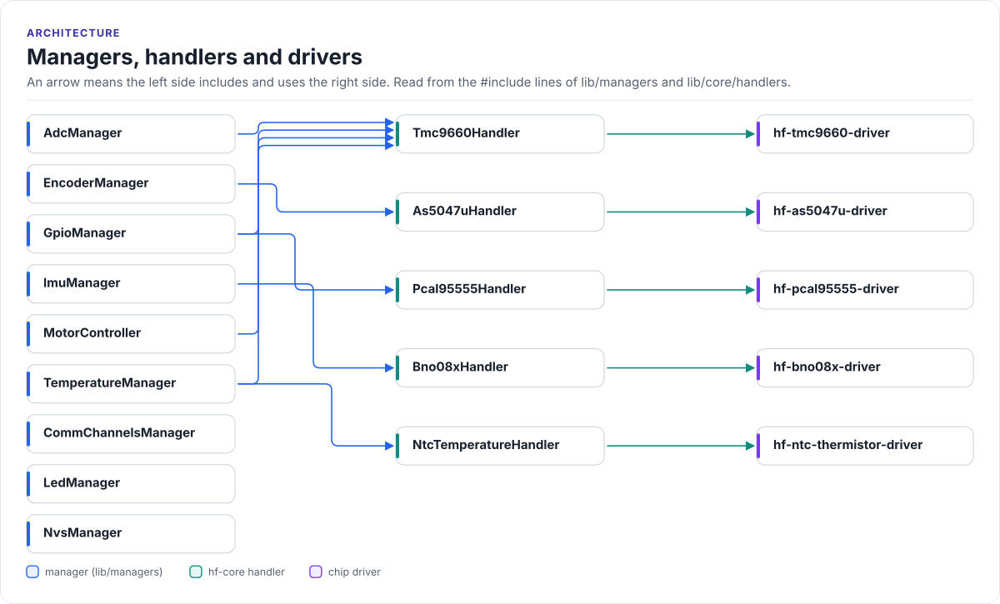

# Ownership

Who creates each object, who owns it, and how memory is allocated. The short version: the facade owns nothing but
references; each manager is a singleton that owns its handlers and bus objects for the life of the program; other
managers borrow them.

<!-- figure: manager-dependencies -->
<picture>
  <source media="(prefers-color-scheme: dark)" srcset="../diagrams/manager-dependencies.dark.svg">
  
</picture>
<!-- /figure -->

## Managers, handlers and drivers

<!-- generated: manager-map -->
From the `#include` lines of
[`lib/managers`](../../lib/managers) and the hf-core handlers; do not edit.

| Manager | Uses managers | hf-core handlers (driver) | Drivers used directly | Interface classes |
| --- | --- | --- | --- | --- |
| [`AdcManager`](../../lib/managers/AdcManager.h) | `MotorController` | `tmc9660` (hf-tmc9660) | - | `BaseAdc` |
| [`CommChannelsManager`](../../lib/managers/CommChannelsManager.h) | - | - | - | `BaseCan`, `BaseI2c`, `BaseSpi`, `BaseUart` |
| [`EncoderManager`](../../lib/managers/EncoderManager.h) | `CommChannelsManager`, `GpioManager` | `as5047u` (hf-as5047u) | - | `BaseGpio`, `BaseSpi` |
| [`GpioManager`](../../lib/managers/GpioManager.h) | `CommChannelsManager`, `MotorController` | `pcal95555` (hf-pcal95555), `tmc9660` (hf-tmc9660) | - | `BaseGpio` |
| [`ImuManager`](../../lib/managers/ImuManager.h) | `CommChannelsManager`, `GpioManager` | `bno08x` (hf-bno08x) | - | `BaseGpio`, `BaseI2c`, `BaseSpi` |
| [`LedManager`](../../lib/managers/LedManager.h) | - | - | - | - |
| [`MotorController`](../../lib/managers/MotorController.h) | `CommChannelsManager`, `GpioManager` | `tmc9660` (hf-tmc9660) | - | - |
| [`NvsManager`](../../lib/managers/NvsManager.h) | - | - | - | `BaseNvs` |
| [`TemperatureManager`](../../lib/managers/TemperatureManager.h) | `AdcManager`, `MotorController` | `ntc` (hf-ntc-thermistor), `tmc9660` (hf-tmc9660) | - | `BaseTemperature` |
<!-- /generated -->

## Singletons

Every manager is a function-local static (`GetInstance()`, a Meyers singleton): it is constructed on first use and
never destroyed. `Vortex` itself is one, and its members (`vortex.comms`, `vortex.motors`, ...) are references to
the manager singletons, bound in its constructor. So `vortex.motors` and `MotorController::GetInstance()` are the
same object; prefer the facade in application code so the start-up order is respected.

## Who owns what

| Object | Owner | How other code reaches it |
| --- | --- | --- |
| SPI2 bus and its device handles, I2C bus and devices, UART, TWAI | The board binding (static storage in `bsp_bind/esp32c6/`); `CommChannelsManager` holds device indices and bounded runtime I2C slots | `GetSpiDevice()`, `GetI2cDevice()`, `GetUartBus()`, `GetCanBus()` return borrowed pointers |
| `Tmc9660Handler` (onboard at index 0, external TMC9660s at indices 2 and 3) | `MotorController` (`std::array<std::unique_ptr<Tmc9660Handler>, 4>`) | `handler(index)`, `visitDriver()`; `GpioManager`, `AdcManager` and `TemperatureManager` borrow the onboard handler |
| `Pcal95555Handler` | `GpioManager` | Through the expander pins it registers |
| GPIO pin objects | Static storage (see below); `GpioManager` holds one `BaseGpio*` per registered pin | `Get(name)` / `Get(enum)` return a `BaseGpio*`, valid until `GpioManager` is de-initialised |
| `Bno08xHandler` (onboard at index 0, up to three external) | `ImuManager` | `GetBno08xHandler(index)` |
| `As5047uHandler` (none by default, up to four) | `EncoderManager` | `GetAs5047uHandler(index)`, `GetAs5047uDriver(index)` |
| `Tmc9660AdcWrapper` | `AdcManager` | `Get(name)` / `Get(enum)` return `BaseAdc*` |
| ESP32 die temperature sensor | The board binding | `TemperatureManager` reads it by name |
| `NtcTemperatureHandler`, TMC9660 temperature wrapper | `TemperatureManager` | Read calls by sensor name |
| WS2812 status LED (`Ws2812Handler`) | The board binding | `LedManager` calls only |
| Three NVS namespaces | The board binding | `NvsManager::App()`, `Calibration()`, `Config()` return `BaseNvs&` |

Borrowed pointers and references stay valid until the owning manager is de-initialised (`Vortex::Shutdown()` or the
manager's own `Deinitialize()`). Do not keep them across a shutdown.

## GPIO pins have three owners

`GpioManager` stores every pin as a plain `BaseGpio*`; no pin object is on the heap or reference counted. The
objects come from three places:

- **ESP32 pins**: the board binding creates them (`McuGpioOpen()`, static storage).
- **PCAL95555 pins**: `GpioManager` keeps them in a fixed array of 16 and attaches each to the expander handler
  (`Pcal95555Handler::AttachStaticPin()`); they are destroyed, after their pointers are cleared, in `Deinitialize()`.
- **TMC9660 pins** (`TMC_GPIO17`, `TMC_GPIO18`): the TMC9660 handler owns them. They are registered by
  `RegisterTmc9660BridgePinsIfNeeded()` once the onboard handler has come up, and removed by
  `UnregisterTmc9660BridgePins()`, which `MotorController::Deinitialize()` calls before it destroys the handler.

So a pointer from `Get()` cannot outlive its object: every owner clears the entry before the object goes.

## Allocation

Device tables are fixed-size arrays sized at compile time (from the pin map or a `MAX_*_DEVICES` constant), and the
objects in them live in place: handlers in `std::optional` slots (`MotorController`, `ImuManager`,
`EncoderManager`, `AdcManager`, `TemperatureManager`, the PCAL95555 handler), pin objects in fixed arrays, buses in
the board binding's static storage. Nothing in `lib/api` or `lib/managers` calls `new`, `make_unique` or
`make_shared`, and no manager stores a `std::function`. A host test counts `operator new` during steady-state calls
(LED, GPIO, bus lookups, `CollectDiagnostics()`) and requires zero. Allocation still happens inside hf-core handlers
and ESP-IDF drivers while they initialise; [ADR 0002](../adr/0002-static-allocation.md) records the rule and that
boundary.
