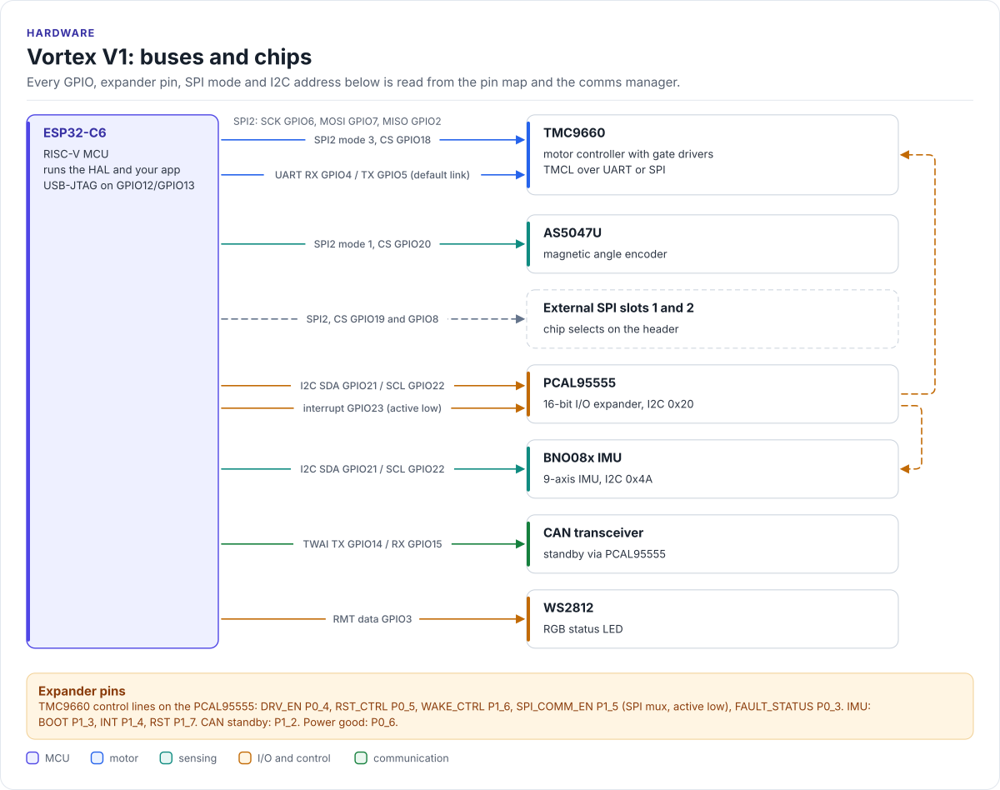
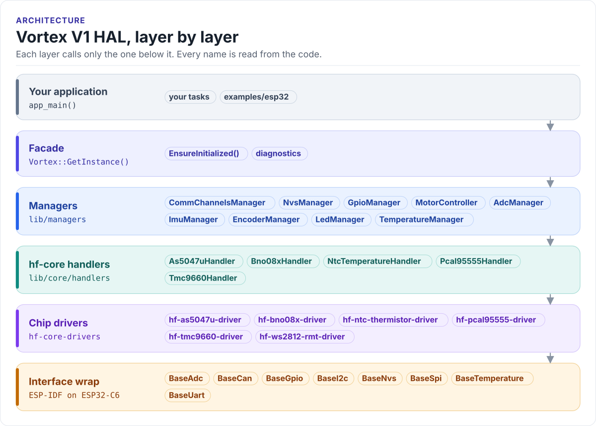
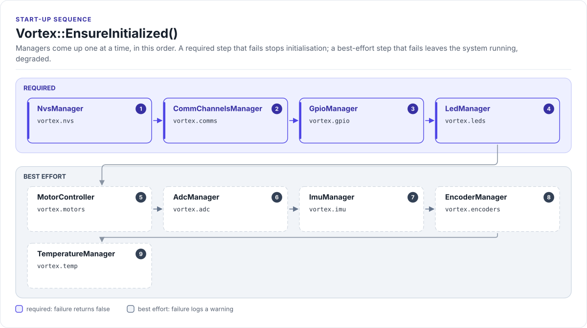
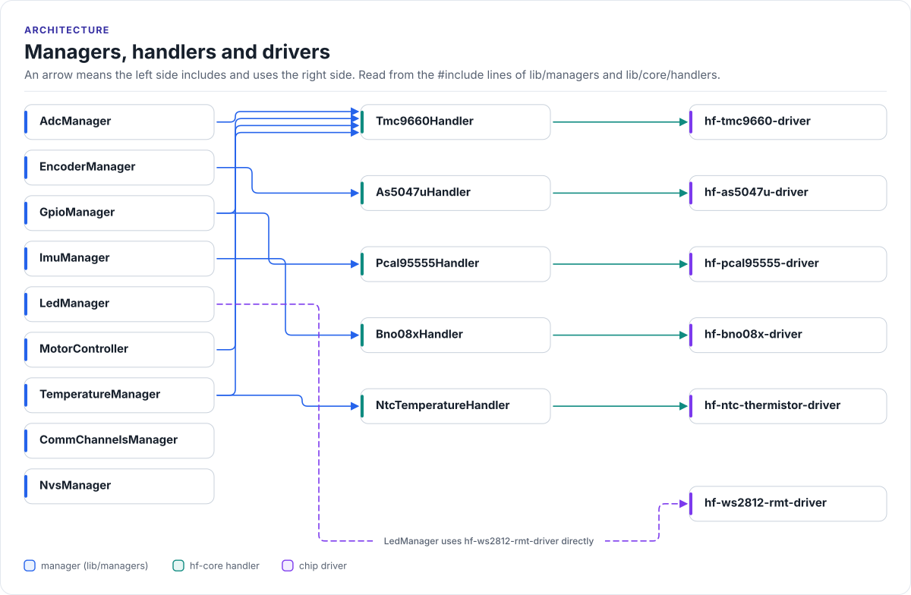

# Figures

<!-- Generated by tools/figkit/build.py from docs/diagrams/figures/*.py. Do not edit by hand. -->

Every figure on this site is drawn by a Python module from facts extracted from the code, so it is rebuilt,
not redrawn, when the code changes. CI runs `python3 tools/figkit/build.py --check` and fails when a
committed figure no longer matches the code. Each figure below lists the files it is drawn from.

## Vortex V1: buses and chips

<!-- figure: board-overview -->
<picture>
  <source media="(prefers-color-scheme: dark)" srcset="board-overview.dark.svg">
  
</picture>
<!-- /figure -->

Figure module: [`docs/diagrams/figures/board-overview.py`](../../docs/diagrams/figures/board-overview.py)

Drawn from:

- `HF_FUNCTIONAL_GPIO_PIN_LIST` in [`lib/core/hf-core-drivers/internal/hf-pincfg/src/hf_functional_pin_config_vortex_v1.hpp`](../../lib/core/hf-core-drivers/internal/hf-pincfg/src/hf_functional_pin_config_vortex_v1.hpp)
- `SpiDeviceId` in [`lib/managers/CommChannelsManager.h`](../../lib/managers/CommChannelsManager.h)
- `add_builtin_device` in [`lib/managers/CommChannelsManager.cpp`](../../lib/managers/CommChannelsManager.cpp)

## Vortex V1 HAL, layer by layer

<!-- figure: hal-layers -->
<picture>
  <source media="(prefers-color-scheme: dark)" srcset="hal-layers.dark.svg">
  
</picture>
<!-- /figure -->

Figure module: [`docs/diagrams/figures/hal-layers.py`](../../docs/diagrams/figures/hal-layers.py)

Drawn from:

- `Vortex (manager references)` in [`lib/api/Vortex.h`](../../lib/api/Vortex.h)
- `#includes` in [`lib/managers`](../../lib/managers)
- `#includes` in [`lib/core/handlers`](../../lib/core/handlers)

## Vortex::EnsureInitialized()

<!-- figure: init-order -->
<picture>
  <source media="(prefers-color-scheme: dark)" srcset="init-order.dark.svg">
  
</picture>
<!-- /figure -->

Figure module: [`docs/diagrams/figures/init-order.py`](../../docs/diagrams/figures/init-order.py)

Drawn from:

- `Vortex::InitializeAllComponents` in [`lib/api/Vortex.cpp`](../../lib/api/Vortex.cpp)

## Managers, handlers and drivers

<!-- figure: manager-dependencies -->
<picture>
  <source media="(prefers-color-scheme: dark)" srcset="manager-dependencies.dark.svg">
  
</picture>
<!-- /figure -->

Figure module: [`docs/diagrams/figures/manager-dependencies.py`](../../docs/diagrams/figures/manager-dependencies.py)

Drawn from:

- `#includes` in [`lib/managers`](../../lib/managers)
- `#includes` in [`lib/core/handlers`](../../lib/core/handlers)
