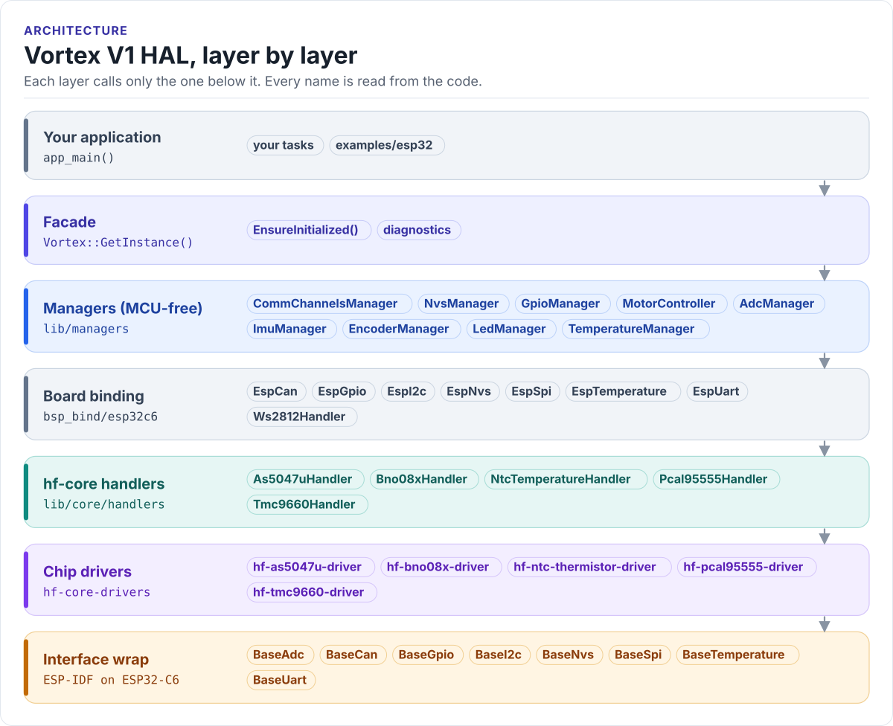

---
hide:
  - navigation
  - toc
---

HardFOC board HAL

# Vortex V1 HAL

The software layer for the HardFOC Vortex V1 motor controller board. One `Vortex` object gives your ESP32-C6
application the TMC9660 motor controller, encoders, the IMU, temperatures, ADC channels, GPIO, CAN, storage and a
status LED, through a small set of managers that know the board's wiring.

[Quickstart](quickstart.md){ .md-button .md-button--primary }
[Architecture](architecture/index.md){ .md-button }
[Source on GitHub](https://github.com/hardfoc/hf-hal-vortex-v1){ .md-button }

This repository (`hf-hal-vortex-v1`) turns the board into C++ objects. Your application does not touch GPIO
numbers or SPI frames; it calls `vortex.motors`, `vortex.encoders`, `vortex.temp`.

Single-axis motor controller board
Vortex V1
HardFOC

MCU
:   ESP32-C6 (RISC-V, Wi-Fi 6, BLE, 802.15.4, TWAI); ESP-IDF release/v5.5

Motor controller
:   TMC9660: integrated gate drivers, on-chip FOC current, velocity and position loops; BLDC, stepper or brushed
    DC; host link UART 115200 baud (default) or SPI2

Sensors
:   AS5047U 14-bit magnetic angle encoder slot (SPI2) · BNO08x 9-axis IMU (I2C) · NTC thermistor on TMC9660 AIN3

I/O
:   PCAL95555 16-bit I2C expander: TMC9660 control lines, IMU boot and reset, CAN standby, power good

Communication
:   CAN 500 kbit/s (TWAI) · I2C 100 kHz · USB Serial/JTAG (console, flashing)

Power
:   Motor supply, needed only to spin a motor; the board starts and logs from USB without it

Status
:   One WS2812 RGB LED

[Hardware](hardware/index.md) · [Pin map](hardware/pin-map.md)

<!-- figure: hal-layers -->
<picture>
  <source media="(prefers-color-scheme: dark)" srcset="diagrams/hal-layers.dark.svg">
  
</picture>
<!-- /figure -->

## What you get

- One `Vortex` object that brings the board up in a fixed order and reports what failed
  ([Initialisation](architecture/initialization.md)).
- One manager per board function: motor, encoders, IMU, ADC, temperature, GPIO, LED, communication, storage
  ([Managers](managers/index.md)).
- The TMC9660 over UART or SPI, with unit-aware motor- and load-frame velocity and position, and every TMCL
  parameter through `visitDriver()` ([MotorController](managers/motors.md)).
- A pin map generated from the board's pin header, across the ESP32-C6, the PCAL95555 and the TMC9660
  ([Pin map](hardware/pin-map.md)).
- Diagnostics for every manager: `GetLastError()`, health snapshots, statistics dumps
  ([Errors and diagnostics](architecture/errors.md)).
- Example and bench apps for every chip, most built by CI on every pull request ([Examples](examples/index.md)).

## Where to go next

- :material-rocket-launch-outline: **[Quickstart](quickstart.md)**

    Install ESP-IDF, clone with submodules, build, flash and watch the first example.

- :material-wrench-outline: **[Bring-up and troubleshooting](bring-up.md)**

    The first power-up, step by step, and what each start-up failure means.

- :material-chip: **[Hardware](hardware/index.md)**

    Buses, chips and the pin map, generated from the board's pin header.

- :material-layers-outline: **[Architecture](architecture/index.md)**

    Layers, start-up order, ownership, threading and errors.

- :material-engine-outline: **[Managers](managers/index.md)**

    One page per manager: what it does, its API, an example and its pitfalls.

- :material-play-box-outline: **[Examples](examples/index.md)**

    Every buildable app, generated from `app_config.yml`.

